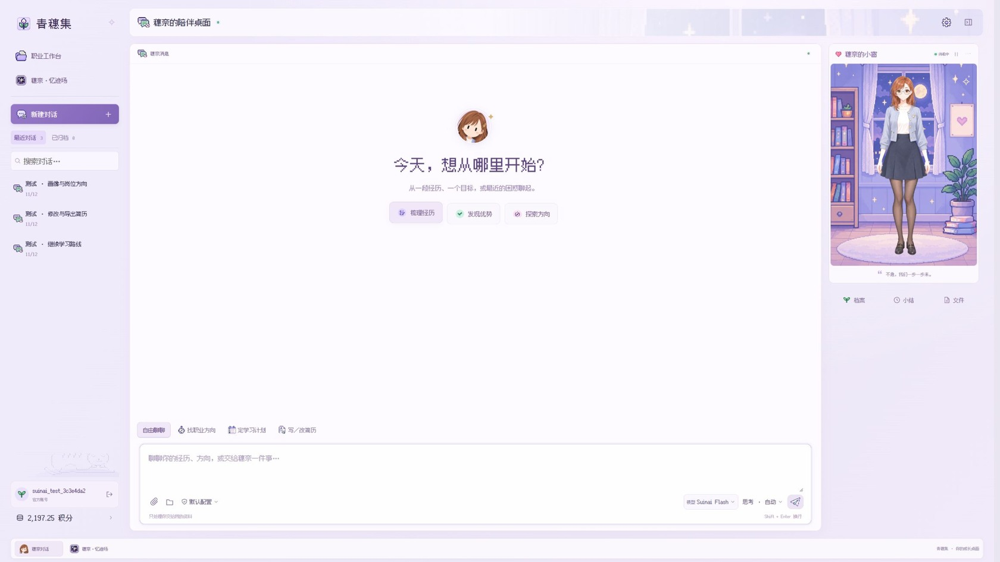
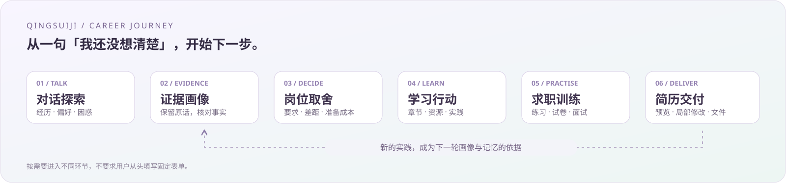
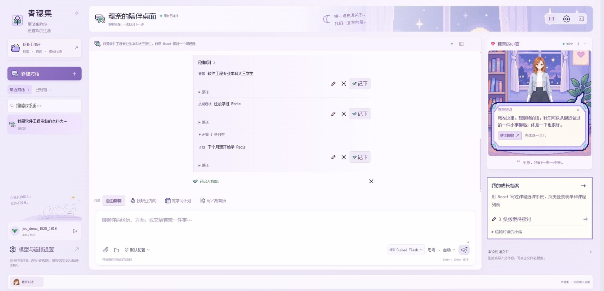
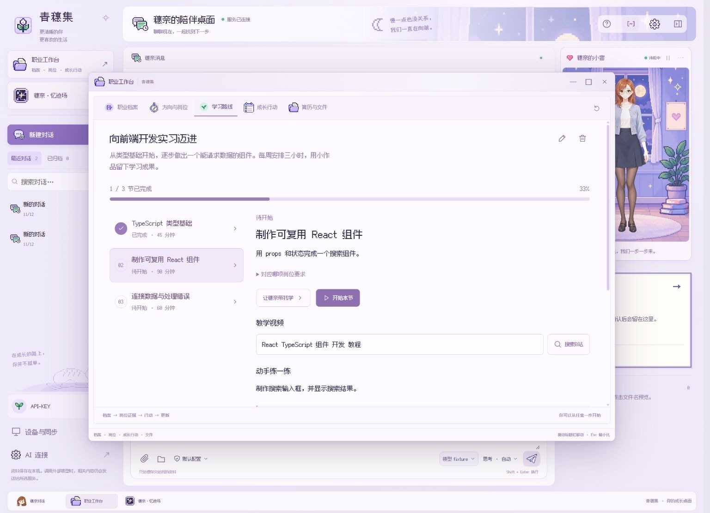
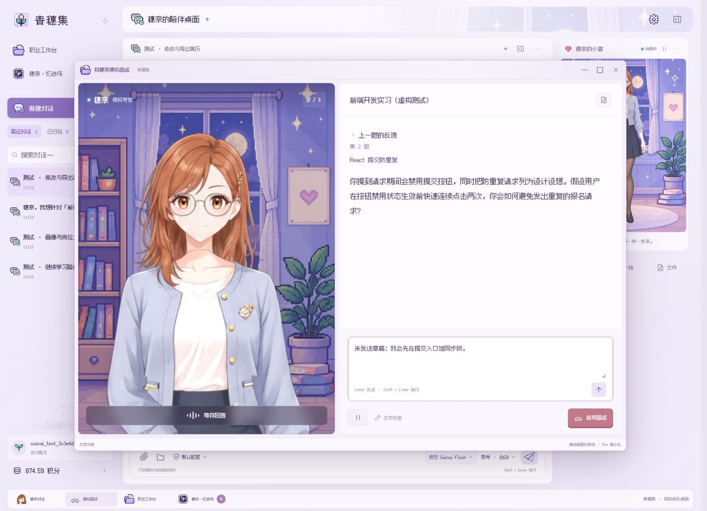
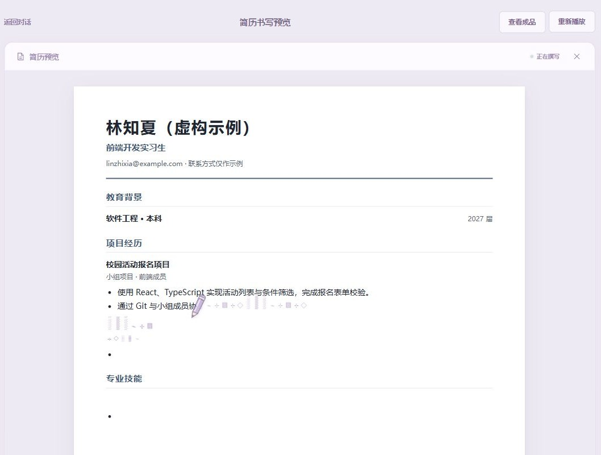
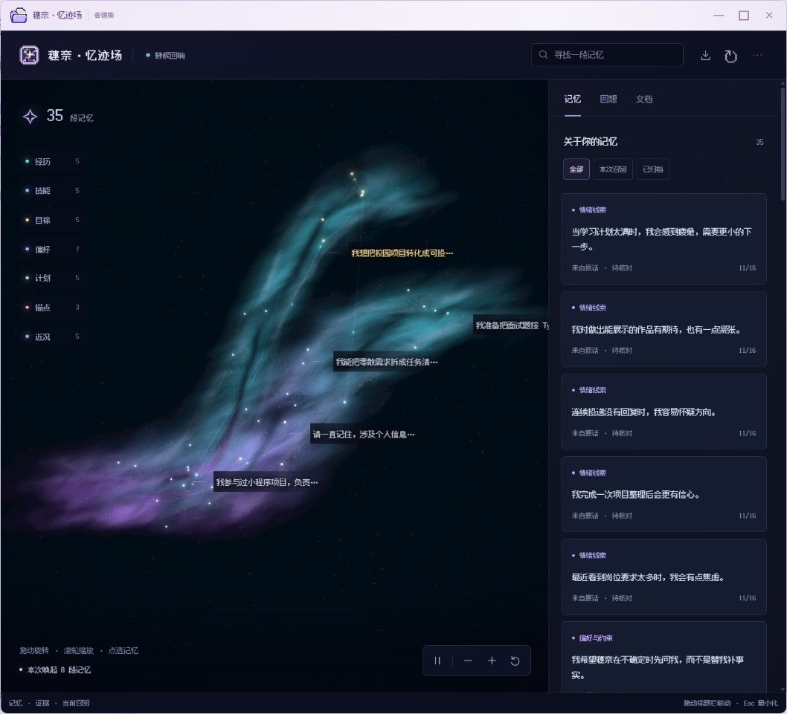
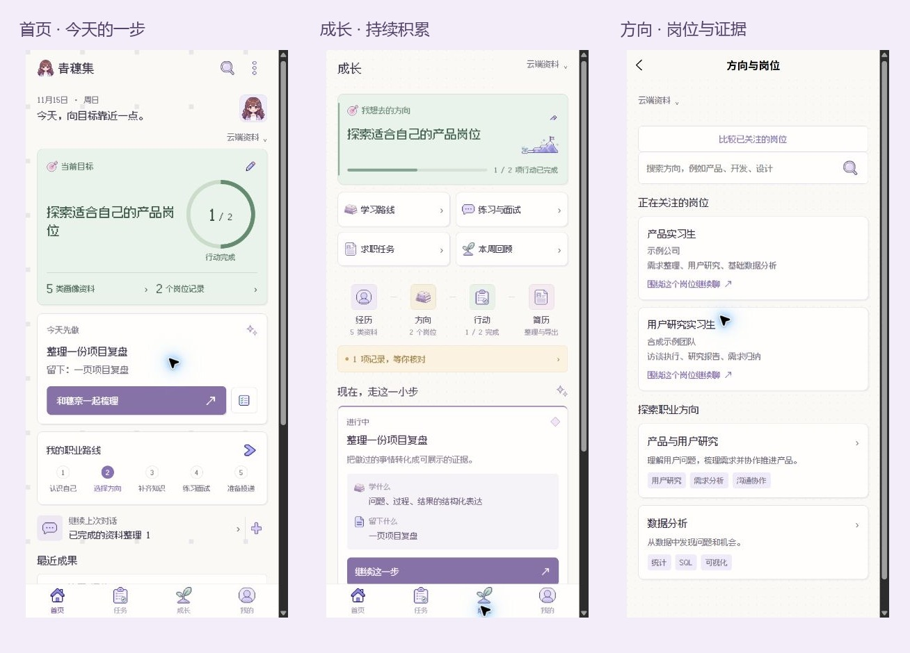
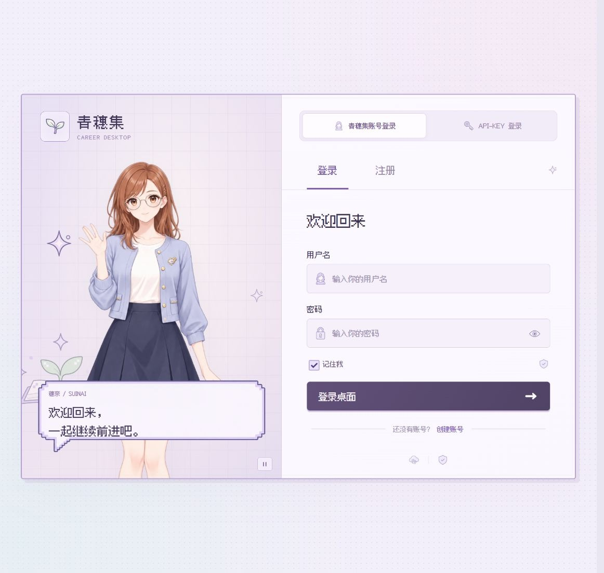
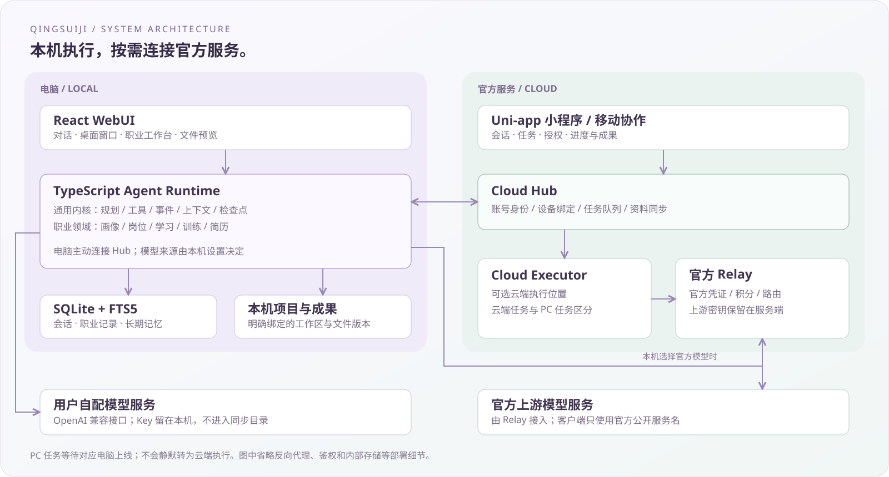

<div align="center">

# 青穗集 · 穗奈 Agent

**陪你从「不知道做什么」，走到有方向、有行动、有准备。**

面向大学生的对话式职业规划与求职成长智能体

TypeScript · React · Node.js · SQLite · Three.js · Uni-app

[在线体验](https://agent.suinai.me) · [功能展示](#功能展示) · [快速开始](#快速开始) · [技术架构](#技术架构) · [开发文档](#开发文档)



</div>

## 青穗集是什么

青穗集希望把职业准备变成一个能持续推进的过程：从聊清楚自己做过什么、在意什么开始，逐步找到目标岗位，明确需要补齐的能力，进入学习与训练，最后把真实积累整理成求职材料。

穗奈是这个过程中的对话伙伴，也是能够规划任务、读取材料、调用工具和交付文件的 Agent。主界面保持对话，职业工作台、学习路线、模拟面试、简历预览和长期记忆则在需要时以独立窗口展开。



**简历是成长过程中的一份产物，真实经历与职业方向才是贯穿全程的主线。**

## 功能展示

以下图片来自实际运行界面，使用隔离测试或虚构示例资料；移动端图片为 H5 合成数据预览。部分截图来自不同开发阶段，采集日期与裁剪记录见[配图说明](docs/readme/README.md)。

### 从聊天里认识你，把依据留下来

不需要先填完一张长表。你可以讲一段项目经历、导入旧简历，或从眼前的困惑开始。穗奈会整理经历、技能、偏好和目标线索，并保留对应的用户原话与材料依据；正式画像更新由你核对确认。

画像与职业工作台承接这些记录，让后续的岗位比较、学习计划和简历写作使用同一份事实基础。



### 找方向，也看准备成本

岗位探索结合离线岗位参考库与已有画像，查看岗位详情、专业要求和技能差距。你可以保存感兴趣的岗位、加入下一步，再比较吸引点、准备成本、取舍和仍需核实的问题。

岗位库提供的是参考样本；建议用于理解方向与要求，实时招聘状态仍需到招聘平台核实。

### 从「想学」走到今天能做的一步

确定岗位后，把差距拆成学习章节、练习与项目行动。学习窗口支持检索 B 站教学资源、关联视频链接和记录进度，不需要在平台存储整套教学视频。



### 穗奈担任考官，在独立窗口里练习

岗位练习、模拟试卷与模拟面试服务于不同的准备阶段。模拟面试使用独立的通话式窗口：穗奈展示问题，你在下方输入回答，逐题推进，也可以暂停、结束并复盘。

目前采用文字作答。训练中假设的经历与答案不会作为你的真实项目经历写入正式画像或长期记忆。



### 看着简历写出来，框选一段继续改

简历先对齐真实材料与目标岗位，再进入结构化改写和模板排版。侧栏展示生成过程，文字逐步呈现在纸面上，书写位置配有动画反馈；你也可以框选局部、输入修改要求，并继续调整同一份简历。

生成的文件通过对话链接交付，支持预览、下载，以及本机模式下的打开操作。不同模板复用同一份简历数据，事实核对与版式选择分开处理。



### 忆迹场：让记忆可见，也能纠正和遗忘

忆迹场以可旋转、缩放与点选的三维星云展示记忆，支持查看原话、回想依据、纠正、归档与删除。星云是交互可视化，节点内容与本次召回则来自记忆记录。

底层采用 SQLite FTS5、中文二元词检索、词项 MMR 去重和时间衰减；需要时复用当前聊天模型筛选有限候选，不要求再下载一个本地向量模型。



### 电脑执行，手机也能接着推进

PC 提供本机 API Key 与官方账号两种入口。登录官方账号后仍可使用自己的模型接口；启用相应同步并绑定设备后，小程序可以继续电脑会话、下发任务、处理授权、查看进度与成果。

电脑主动连接 Cloud Hub，无需把本机端口暴露到公网。电脑任务等待对应电脑执行；选择云端模式时，由独立的云端执行器处理。两种执行来源在会话中保持可辨识。



<details>
<summary>查看 PC 登录入口</summary>

PC 可以选择官方账号或 API Key；云端 WebUI 使用官方账号。官方模型调用与第三方模型配置分别维护。



</details>

## 快速开始

### 环境准备

- **Node.js 22.19 或更高版本**：项目声明的最低版本为 22.17，部分原生组件的传递依赖要求 22.19，建议统一使用后者或更新版本。
- **Git 与 npm**。本机使用和内测发行优先支持 Windows 10 / 11 x64。
- **一个可用的模型接口**：可自配 OpenAI 兼容服务，也可连接已部署的官方服务。模型调用需要联网，并可能产生费用。

### 启动开发环境

```powershell
git clone https://github.com/NatsuNagi0420/career-decision-system.git
cd career-decision-system
npm run setup
npm run dev
```

打开 **http://127.0.0.1:5188/**。该命令同时启动前端与本机 Agent，前端固定使用 5188，端口被占用时直接报错。

首次使用可选择 **API-KEY 登录**，在模型与连接设置中填写 Base URL 和 API Key，拉取模型列表、选择模型并测试连接。聊天、流式输出与工具往返分别检查；需要 Agent 执行任务时，应选择通过工具测试的模型。

也可以连接官方账号。新克隆的源码默认没有官方服务配置，如需连接当前官方部署，在 `agent/` 下将 `.env.example` 复制为 `.env`，并配置公开入口：

```dotenv
AGENT_CLOUD_URL=https://agent.suinai.me
OFFICIAL_GATEWAY_URL=https://api.suinai.me/v1
OFFICIAL_MODEL=Suinai Flash
OFFICIAL_MODEL_DISPLAY_NAME=Suinai Flash
```

随后重启本机 Agent，在页面登录官方账号。这里填写的是服务入口与公开模型名；真实上游密钥和内部模型路由保留在官方服务端。`Suinai Flash` 是服务展示名称。

### 可以从这几句话开始

> 我是大三学生，做过一个校园项目，但不知道适合投什么岗位。先帮我梳理经历，再比较几个方向。

> 这是我想投的岗位 JD。结合已有资料，帮我找出差距，安排一条能逐步完成的学习路线。

> 读取我选中的项目，核对实际实现与我的职责，再把能够证明的部分整理成简历项目经历。

读取本机项目时，先用输入区的项目入口绑定目录。工作区读写与命令执行遵循当前权限和沙箱状态。

<details>
<summary>生产构建与 Windows 安装包</summary>

源码构建后由本机 Agent 提供已构建的 WebUI：

```powershell
npm run build
npm start
```

此时访问 **http://127.0.0.1:8110/**。开发环境的 5188 与生产服务的 8110 是运行方式不同，均连接相应的 Agent 数据与账号，端口本身不会产生第二套账号。

仓库包含 Windows 安装向导、桌面快捷方式、单实例启动和托盘退出实现。发行构建入口为 `npm run release:windows`，需要额外准备 Node 发行包与 Inno Setup 等构建工具；参数与当前发行限制见 [Windows 发行说明](desktop/windows/README.md)。

关闭浏览器后，本机后台服务仍可运行；选择「完全退出」才会停止本机服务和任务。

</details>

<details>
<summary>开发与构建小程序</summary>

```powershell
cd uni-app
npm ci
npm run dev:mp-weixin
```

使用微信开发者工具导入 `uni-app/dist/dev/mp-weixin`。H5 预览使用 `npm run dev:h5`；正式构建分别使用 `npm run build:mp-weixin` 和 `npm run build:h5`。

接口地址通过 `uni-app/.env.example` 中的 `VITE_AGENT_API_ORIGIN` 配置；真机还需配置微信合法域名。详见[小程序说明](uni-app/README.md)。

</details>

## 技术架构



| 层次 | 实现 | 职责 |
| --- | --- | --- |
| PC / Web 界面 | React 19、Vite、TypeScript | 主对话、桌面窗口、职业工作台、文件与简历预览 |
| 角色与动效 | 分层原画、Canvas 网格动画、Three.js、Lottie | 穗奈动作、三维记忆和界面微交互 |
| 移动协作端 | Vue 3、Uni-app | 任务下发、授权、进度、成长资料与成果查看 |
| Agent Runtime | Node.js、TypeScript、Fastify、Zod | 执行循环、工具契约、上下文管理、审批与恢复 |
| 业务与记忆 | SQLite、FTS5 | 会话、职业事实、岗位样本、学习、简历和长期记忆 |
| 官方服务 | Relay、Cloud Hub、可选 Cloud Executor | 账号、积分、模型路由、设备同步与云端任务 |

### Agent 内核与职业能力分层

- **执行可观察**：模型、工具和任务状态通过 SSE 推送，命令输出进入执行侧栏；事件持久化后可按序重放。
- **长任务可恢复**：上下文按预算整理，保留工具调用与结果配对、持久计划和检查点；中断后不盲目重跑执行结果不确定的工具。
- **业务事实可追溯**：模型提出结构化草稿，程序校验来源、字段和修订版本；正式画像、岗位决策和简历保留各自确认边界。
- **成果持续修改**：文件登记不可变版本，简历预览与正式保存分离；局部编辑限定字段及版本，减少整份覆盖。
- **模型来源可切换**：自配接口支持 Chat Completions / Responses 兼容接入、模型列表与能力测试；官方能力编排留在服务端。

对应实现可从 [`agent-loop.ts`](agent/src/core/agent-loop.ts)、[`tool-registry.ts`](agent/src/core/tool-registry.ts)、[`context-manager.ts`](agent/src/core/context-manager.ts) 和 [`CareerAgentDomain`](agent/src/domain/career/index.ts) 阅读。

### 本机、同步与云端的边界

| 使用方式 | 执行位置 | 模型来源 | 数据与协作 |
| --- | --- | --- | --- |
| PC · API Key 入口 | 本机 | 用户配置的模型服务 | 资料保存在本机；本机身份不进行官方账号同步 |
| PC · 官方账号 | 本机 | 官方服务或自配模型 | 按设备及同步开关同步会话、职业资料和记忆 |
| 小程序 · 电脑任务 | 已绑定电脑 | 沿用电脑设置 | Hub 转发任务、同步进度；电脑离线时等待上线 |
| 云端 Web / 云端任务 | 云端执行器 | 官方服务 | 按官方账号隔离，不开放用户对云端宿主机的直接访问 |

开发端口为 **5188（WebUI）→ 8110（本机 Agent）**。官方中转的内部端口为 **8120**；使用已有官方部署时，用户电脑无需再启动一份中转服务。

## 仓库结构

```text
career-decision-system/
├── web/                     React 桌面、对话与各功能窗口
├── agent/
│   ├── src/core/             通用 Agent 执行内核、工具、事件与上下文
│   ├── src/domain/career/    职业画像、岗位、学习、训练与简历领域
│   ├── src/cloud-hub/        设备绑定、任务转发、同步及云端执行
│   └── test/                单元测试与接口契约测试
├── uni-app/                 小程序与移动 H5
├── assets/web/              由后端只读接口统一提供的网页素材
├── desktop/windows/         Windows 启动器与安装向导
├── deploy/                  Hub、Relay 与云端部署配置模板
├── scripts/                 开发、岗位库导入、验证与发行脚本
└── docs/
    ├── architecture/        架构与领域设计
    ├── agent-foundation/    模型、沙箱、文件和数据库说明
    └── readme/              仓库首页配图与来源说明
```

## 数据、工具与验证

本机账号、会话、画像、岗位参考库和成果记录使用同一份 SQLite 主库；默认位置为：

- Windows：`%LOCALAPPDATA%/Qingsuiji/agent/agent.sqlite`
- Linux / macOS：`$XDG_STATE_HOME/Qingsuiji/agent/agent.sqlite`，未设置时为 `~/.local/state/Qingsuiji/agent/agent.sqlite`

可用 `AGENT_DATA_DIR` 覆盖。新环境不会自动填入真实用户或岗位数据；公共岗位样本需显式导入。导入与备份见[数据库维护说明](docs/agent-foundation/DATABASE_20261024.md)。运行数据、日志、备份和 `.env` 不进入版本库。

常用检查：

```powershell
npm run check
npm test
npm run build
```

Office 文档工具是可选能力：`npm run office:setup` 安装固定版本的 OfficeCLI，`npm run office:verify` 使用隔离数据验证文档生成与交付。接入方式及限制见 [OfficeCLI 说明](docs/agent-foundation/OFFICECLI.md)。

## 当前边界

目前适合小范围内测。以下边界会影响实际体验：

- **岗位与判断**：静态岗位样本不等于实时招聘市场；推荐、训练反馈和模型判断不代表录用概率或能力认证。
- **文件导入**：支持文字版 PDF、DOCX、文本 / 源码及常见图片；不提供扫描件 OCR，图片理解取决于所选模型能力。
- **执行隔离**：Windows 原生沙箱主要限制写入，读取、联网和资源并未完整隔离；其他平台默认选择 Docker，不可用时关闭命令。云端默认禁用宿主命令，不宣称已提供每用户独立容器。
- **角色与交互**：穗奈采用分层角色原画与 Canvas 动画，尚非 Cubism 原生模型；模拟面试目前为文字作答。
- **正式运营**：自动投递、真实支付、密码找回 / 邮箱验证与更大规模生产验证仍需继续完善。仓库更新不会自动更新已部署云服务或已安装客户端。

## 开发文档

| 主题 | 入口 |
| --- | --- |
| Agent 配置与模型接入 | [Agent 使用说明](agent/README.md) · [接口兼容性](docs/agent-foundation/MODEL_PROVIDER_COMPATIBILITY_20261022.md) |
| 执行内核与上下文 | [运行时设计](docs/architecture/AGENT_RUNTIME_CURRENT.md) · [上下文管理](docs/architecture/CONTEXT_MANAGEMENT_20261026.md) |
| 文件与本机沙箱 | [成果交付](docs/agent-foundation/FILE_DELIVERY.md) · [Windows 沙箱](docs/agent-foundation/WINDOWS_NATIVE_SANDBOX_20261022.md) |
| 学习与训练 | [岗位学习](docs/architecture/JOB_LEARNING.md) · [求职训练](docs/architecture/CAREER_PREPARATION.md) |
| 记忆与账号同步 | [记忆系统设计](docs/architecture/SUINAI_MEMORY.md) · [Cloud Hub](deploy/hub/README.md) |
| 官方服务与积分 | [Relay 部署](deploy/relay/README.md) · [积分机制](docs/architecture/OFFICIAL_CREDITS.md) |
| 客户端发行 | [Windows 安装包](desktop/windows/README.md) · [小程序工程](uni-app/README.md) |

历史设计文档保留决策时的名称与端口；当前入口和启动方式以本 README、配置模板及源码为准。

## 参考与许可

执行设计参考了 [DeepSeek Harness](https://github.com/deepseek-ai/deepseek-harness) 等 Agent 项目的思路；Windows 写入限制复用 `@deepseek-ai/dsh-sandbox-windows-acl`，Office 文档工具集成 [OfficeCLI](https://github.com/iOfficeAI/OfficeCLI)。具体依赖及固定版本见各子项目的 `package.json` 与 lockfile。

第三方代码、字体、SDK 与素材遵循各自许可。仓库当前尚未附统一的项目 `LICENSE`，不能据公开可见推定代码、品牌和角色素材可任意再分发。
